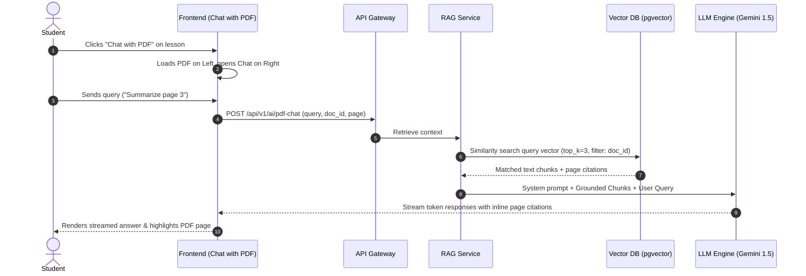
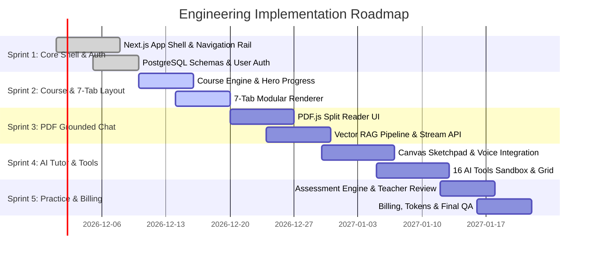
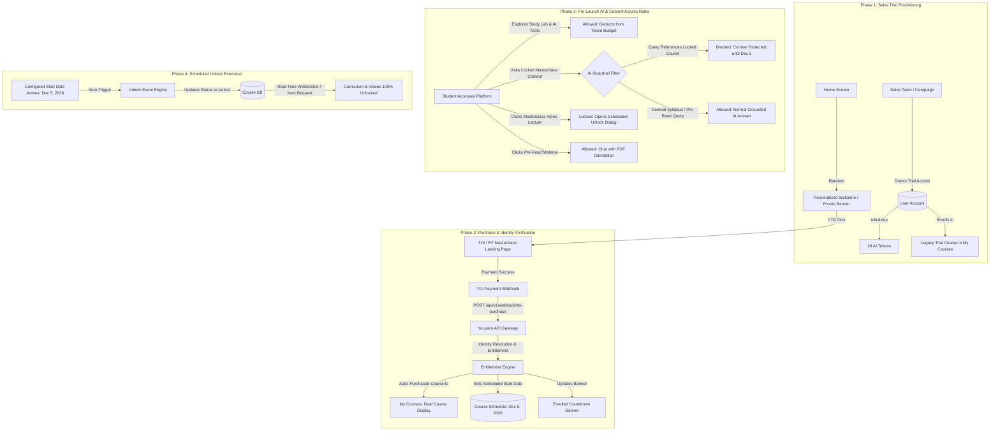

# Product Requirements Document (PRD)
## The Times of India × YoLearn AI Learning Platform

---

> **Document Version:** 1.0.0  
> **Target Audience:** Engineering Leads, Frontend/Backend Architects, AI/ML Engineers, Product Managers, QA  
> **Status:** Ready for Engineering Sprint Planning  
> **Reference Prototype:** [Live Vercel Prototype](https://toi-yolearn-prototype.vercel.app) | [Source Repository](https://github.com/Sarthak2704/toi-yolearn-prototype)

---

## 1. Executive Summary & Product Vision

### 1.1 Objective
The Times of India (TOI), in collaboration with **YoLearn.ai**, is launching an AI-first learning platform for K-12 students (Classes 6–12) and competitive exam aspirants. The platform merges premier AI curriculum content (*The Times of India AI for Students Masterclass / AI BootCamp*) with state-of-the-art interactive AI tutors, canvas sketchpads, document grounding (RAG), and a suite of 16 multimodal AI generation tools.

### 1.2 Core Value Proposition
1. **Interactive Multi-Modal Pedagogy:** Seamless transitions between pre-recorded lectures, live canvas sketchpad tutoring with "Pragya" (AI Tutor), and interactive PDF chat.
2. **Context-Grounded Document AI:** Students never read a static PDF in isolation; every document provides a unified **`Chat with PDF`** experience backed by retrieval-augmented generation (RAG).
3. **Structured AI Tool Ecosystem:** A catalog of 16 specialized AI learning tools (Flashcards, Concept Visualizer, Cheat-Sheet Builder, Mind Map, etc.) with real-time prompt templating.
4. **Co-Branded Credentialing & Verification:** Industry-recognized co-branded certificates issued by *GrowFast — The Times of India* and *YoLearn.ai*, backed by cryptographic verification IDs.

---

## 2. System Architecture & High-Level Design

```mermaid
flowchart TD
    subgraph Client Layer [Frontend - Next.js / React]
        UI_Nav[Navigation Rail & App Shell]
        UI_Course[Course Engine & 7-Tab Layout]
        UI_PDF[PDF Reader & Grounded Chat]
        UI_Tutor[AI Tutor Canvas & Sketchpad]
        UI_Tools[16 AI Tools Showcase & Sandbox]
        UI_Doubt[Global Multimodal Ask-a-Doubt Drawer]
    end

    subgraph API Gateway [Node.js / Express / NestJS]
        Auth_MW[Auth & RBAC Middleware]
        Rate_MW[Token & Rate Limiter]
        Router[REST & WebSocket Router]
    end

    subgraph Core Services [Backend Microservices]
        Course_Svc[Course & Curriculum Service]
        Assessment_Svc[Assessment & Rubric Engine]
        Billing_Svc[Subscription & Token Service]
        User_Svc[Student Profile & Gamification]
    end

    subgraph AI & ML Pipeline [Python / FastAPI / LangChain]
        RAG_Engine[RAG & Vector Search - Pinecone / pgvector]
        LLM_Gateway[Gemini 1.5 Pro / Flash & Claude 3.5]
        Voice_Svc[Text-to-Speech & Speech-to-Text]
        Vision_Svc[Multimodal OCR & Diagram Analyzer]
    end

    subgraph Data Stores
        PostgreSQL[(PostgreSQL - Relational Data)]
        VectorDB[(Vector DB - Curriculum Embeddings)]
        Redis[(Redis - Cache, Sessions & Token Quotas)]
        S3[(AWS S3 / GCS - Videos, PDFs, Assets)]
    end

    Client Layer --> API Gateway
    API Gateway --> Core Services
    Core Services --> AI & ML Pipeline
    Core Services --> PostgreSQL
    Core Services --> Redis
    AI & ML Pipeline --> VectorDB
    AI & ML Pipeline --> S3
```

---

## 3. User Personas & Permissions

| Role | Description | Access Rights |
| :--- | :--- | :--- |
| **Enrolled Student** | K-12 student (Class 6–12) revising concepts, completing modules, and running AI drills. | View enrolled courses, trigger AI Tutor, run AI Tools (quota-limited), submit quizzes, download certificates. |
| **Teacher / Mentor** | School or platform educator monitoring student cohorts. | Review AI-evaluated assessments, override provisional scores, assign module tasks. |
| **Parent / Guardian** | Parent monitoring subscription, token usage, and weekly academic progress. | Access `#s-billing`, purchase add-on token packs, view progress diagnostics. |
| **System Admin** | TOI / YoLearn curriculum manager. | Manage course modules, upload PDFs/videos, configure AI system prompts and rubrics. |

---

## 4. Detailed Feature Specifications

### 4.1 Global Navigation Rail & App Shell
- **Brand Header:**
  - Co-branded logo: *The Times of India AI Learning Platform* + *powered by YoLearn.ai*.
  - Status Indicators: Streak Counter (`🔥 12 days`), Token Balance (`🪙 840 tokens`), Notification Bell (`🔔 7`), Profile Avatar (`RK`).
  - Persistent Header Action: `Ask a Doubt` (opens the slide-out multimodal assistant).
- **Sidebar Rail (`aside.rail`):**
  - **Learn Section:** Home (`#s-dashboard`), My Courses (`#s-courses`), Practice with AI (`#s-practice`).
  - **AI Learning Section:** Learn with AI Tutor (`#s-tutor`), Study Lab (`#s-studylab`), AI Tools (`#s-tools` with badge `16`).
  - **Account Section:** Certificates (`#s-certificates`), Badges (`#s-badges`), Profile (`#s-profile`) *(Billing & subscription management accessible via Profile settings, preserving clean sidebar matching reference UI)*.
- **Responsive Behavior:** Fixed vertical left rail on desktop (≥1024px); collapsible drawer on mobile/tablet viewports (<1024px).

---

### 4.2 Course Overview & 6-Tab Layout (`#s-course`)

#### 4.2.1 Hero Banner
- Course Title: *AI BootCamp for Students* (or *The Times of India AI for Students Masterclass*)
- Badges: `Lifetime access`, `Batch 7`, `Class 6–12`
- Metadata: 5 Modules · 24 Lessons · 8h Video · Unlimited AI Help
- Dynamic Progress Bar: Percentage calculated dynamically (`completed_lessons / total_lessons * 100`), e.g., `62%`.
- Primary CTA: `Continue — Module {current_active_module}` (e.g., `Continue — Module 3`).
- Thumbnail: Video preview card with large play overlay and bottom `⚡ AI layer on every chapter` chip.
- Floating Action Button: Persistent bottom-right floating pill `💬 Ask a Doubt` for instantaneous multimodal assistance.

#### 4.2.2 The 6 Course Tabs
The course features 6 dedicated tabs matching the exact product specification:

```
[ All ]  [ Class ]  [ Pre Read Material ]  [ Additional Resource ]  [ Safety and Security ]  [ Certificate ]
```

1. **Tab 1: All (Everything In It - Consolidated Unified View)**
   - Renders the complete course curriculum and all associated learning artifacts:
     - **Class Modules (1–5):** All video lectures and interactive sessions with dual CTAs:
       - `▶ Watch Video` (soft outline button)
       - `💡 Learn with AI Tutor` (lavender AI button)
     - **Pre-Read Handbooks & Architectural Primers:** PDF list items with dual CTAs:
       - `📄 Open PDF` (soft outline button)
       - `💬 AI Chat` (grounded PDF chat)
     - **Additional Learning Resources:** Reference cheat sheets, vocabulary lexicon, and Python starter kit.
     - **Safety, Security & Ethics Frameworks:** Guidelines on responsible AI usage, student PII privacy, and academic integrity.
     - **Certificate Status Widget:** Live completion counter and progress status.

2. **Tab 2: Class (Only Class Modules & Video Lectures)**
   - Displays exclusively the class modules and scheduled video/interactive lessons (no standalone PDFs or reference lists):
     - **Module 1 · Foundations of AI:** What is AI, Machine Learning intuition, AI all around us.
     - **Module 2 · Neural Networks & Deep Learning:** How brains and neural nets compare, image recognition lab, training your first vision model.
     - **Module 3 · Generative AI & Large Language Models:** How LLMs generate text, Prompting like a Pro, Building your first chatbot.
     - **Module 4 · Computer Vision & Multimodal AI:** Seeing like an AI, Autonomous car vision systems, Generative art.
     - **Module 5 · Capstone AI Project & Career Horizons:** Ideating your student AI project, Pitching & presenting, Careers in AI.
   - Dual action CTAs on every lesson: `▶ Watch Video` and `💡 Learn with AI Tutor`.

3. **Tab 3: Pre Read Material (Dedicated Pre-Read PDF Documents List)**
   - Displays exclusively preparatory reading materials provided prior to live sessions:
     - *Module 1 — AI Foundations Handbook.pdf* (Pre-Session Primer · 6 pages)
     - *Neural Networks & Deep Learning Primer.pdf* (Pre-Session Architecture · 8 pages)
     - *LLM & Transformer Architecture Blueprint.pdf* (Pre-Session Reading · 10 pages)
     - *Computer Vision & Sensor Basics.pdf* (Pre-Session Primer · 5 pages)
   - Dual action CTAs on each document: `📄 Open PDF` (routes to `#s-prereading`) and `💬 AI Chat` (opens grounded AI reader).

4. **Tab 4: Additional Resource (Supplementary PDF Resources List)**
   - Displays exclusively supplementary guides, cheatsheets, and project toolkits:
     - *AI Terms & Vocabulary Lexicon.pdf* (Master Glossary · 12 pages)
     - *Python AI Starter Kit & Code Snippets.pdf* (Developer Guide · 15 pages)
     - *Student Capstone Project Showcase.pdf* (Inspiration & Blueprints · 9 pages)
     - *Comparison Matrix: LLM vs SLM vs Traditional ML.pdf* (Reference Chart · 4 pages)
   - Dual action CTAs on each document: `📄 Open PDF` and `💬 AI Chat`.

5. **Tab 5: Safety and Security (AI Safety, Security & Ethics PDF List)**
   - Displays exclusively safety guidelines, ethical AI policies, and privacy guardrails:
     - *Responsible AI & Student Safety Guidelines.pdf* (Ethical Framework · 7 pages)
     - *Understanding AI Hallucinations & Fact-Checking.pdf* (Safety Playbook · 5 pages)
     - *Student Privacy & PII Protection in AI.pdf* (Data Protection · 4 pages)
     - *Academic Integrity & Citation Policy for AI-Assisted Work.pdf* (Compliance Guide · 6 pages)
   - Dual action CTAs on each document: `📄 Open PDF` and `💬 AI Chat`.

6. **Tab 6: Certificate (Unlocks When Course Completed)**
   - **Locked State (When Progress < 100%):**
     - Shows dynamic progress meter (e.g. 62% completed, 15/24 lessons done, 9 remaining).
     - Live unlock requirements checklist:
       - Complete all 24 class lessons & live sessions (15/24 done)
       - Score ≥80% average on module quizzes (88% achieved)
       - Submit Capstone AI Project (Pending review)
       - Abide by AI Safety & Ethics pledge (Pledged)
     - Interactive Demo Toggle: `✨ Simulate 100% Completion` allowing test evaluators to preview the certificate unlock.
   - **Unlocked State (When Course Completed - 100%):**
     - Renders official co-branded certificate: *The Times of India × YoLearn Certified Student AI Specialist*.
     - Shows verified Credential ID (e.g. `TOI-YL-2026-B7-8942`), Student Name, Issue Date, and Verification Badge.
     - Download & verification CTAs: `Download PDF Certificate` and `Verify Online`.

---

### 4.3 Unified PDF Reader & Grounded AI Chat (`#s-prereading`)

Whenever a user clicks **`Chat with PDF`** anywhere on the platform, the platform routes to the unified PDF Chat experience:

#### 4.3.1 Left Column: Document Viewer (60% width)
- **Document Header Bar:**
  - File icon + File Name (e.g., `Prompting Handbook.pdf`).
  - Page switcher: `◀ Page {current} of {total} ▶`.
  - Zoom controls: `+` (Zoom in) / `−` (Zoom out) with clamp [12px, 22px].
  - `Download PDF` button with watermark / student attribution.
- **Reading Canvas:**
  - High-fidelity PDF rendering (via PDF.js or pre-rendered vector text).
  - AI Highlight markers indicating key sections referenced in chat.
- **Footer Bar:**
  - Estimated reading time and curriculum verification badge.

#### 4.3.2 Right Column: Grounded AI Tutor Panel (40% width)
- **Tutor Header:**
  - Avatar of Pragya AI with live online status indicator.
  - Subtitle: `Grounded in: {current_pdf_title}`.
  - Badge: `⚡ Active Grounding`.
- **Audio Control Card:**
  - `AI Voice Answers` toggle (`Read Aloud` via ElevenLabs / Web Speech API).
- **Interactive Chat Feed:**
  - Auto-initializes with a contextual greeting grounded in that specific document.
  - Supports markdown rendering, bold highlights, LaTeX formulas, and bulleted steps.
- **Pre-Configured Quick Chips:**
  - `📖 Explain concept`
  - `📋 3-bullet summary`
  - `❓ Quiz me (2 Qs)`
  - `⚡ Exam revision`
- **Multimodal Drawer Input:**
  - Text input with `Enter` submission.
  - Pulsing voice dictation button (`mic`).
  - Send button.
  - Backend integration: Prompts are passed to RAG pipeline with top-k chunks from the active PDF injected into system context.

---

### 4.4 Live AI Tutor with Canvas Sketchpad (`#s-tutor`)

- **Whiteboard & Sketchpad:**
  - Real-time HTML5 2D Canvas allowing freehand drawing with touch, pen stylus, and mouse.
  - Canvas Tools: Pen, Shapes (Rectangle, Circle), Text tool, Clear/Eraser.
  - High-DPI support (`devicePixelRatio` scaling).
- **AI Tutor (Pragya) Live Reasoning:**
  - AI writes step-by-step math and science solutions directly onto the sketchpad while simultaneously streaming chat explanations.
  - Text-to-speech synchronization.

---

### 4.5 Study Lab (`#s-studylab`)

- **Design Standard:** Matches Macmillan YoLearn Hero with soft pastel gradients and warm grid background.
- **Hero Title:** *"What will you **learn** today?"* with a white sticker accent over "learn".
- **Multi-Source Input Box:**
  - Tabs: `YouTube`, `PDF`, `Doubt`.
  - Dynamic input placeholder: URL for YouTube, File picker for PDF, text box for Doubt.
  - Rainbow-gradient border highlight.
  - Primary CTA: `Get Started →`.
- **4 Recent Study Cards:**
  - Card 1: `Neural Network Architecture (Module 2)` (PDF preview, 18 days ago)
  - Card 2: `Complete INORGANIC CHEMISTRY OneShot` (Video thumbnail with teacher photo, 18 days ago)
  - Card 3: `Why auto forwarding...` (Doc preview, 18 days ago)
  - Card 4: `Natural Language Processing & LLMs (Module 3)` (PDF preview with red badge, 22 days ago)
- **Processed Result Card:**
  - Instant extraction of concepts, flashcards, quiz generator, and a direct `💬 Chat with PDF` action.

---

### 4.6 AI Tools Showcase & Sandbox (`#s-tools`)

A catalog of 16 purpose-built educational AI tools rendered in a responsive 4-column grid:

| # | Tool Name | Category | Primary Function | Output Format |
| :- | :--- | :--- | :--- | :--- |
| 1 | **Concept Explainer** | Text & Mnemonic | Video/text/visual explanation with companion analogies. | Rich Text & Analogy Cards |
| 2 | **Concept Visualizer** | Visual & Infographic | Generates labeled diagrams and component blueprints. | SVG / HTML Visual Diagram |
| 3 | **Flashcards** | Interactive & Multimedia | Spaced repetition flashcards with flip animation. | Interactive Card Deck |
| 4 | **Flowchart Generator** | Visual & Infographic | Dynamic flowchart of biological and physical cycles. | Mermaid / SVG Flowchart |
| 5 | **Formula & Cheat Sheet Builder**| Templates & Kits | Compresses 1–3 textbook chapters onto 1 reference page. | Formatted Printable PDF |
| 6 | **Infographic Generator** | Visual & Infographic | Summarizes AI BootCamp topics into a 1-page visual overview. | Visual Card Matrix |
| 7 | **Mind Map** | Visual & Infographic | Hierarchical concept tree connecting core formulas. | Interactive Tree Graph |
| 8 | **Mnemonic Generator** | Text & Mnemonic | Creative acronyms, stories, and memory hooks. | Structured Mnemonic List |
| 9 | **Mock Test** | Interactive & Multimedia | Timed exam simulations with speed & accuracy metrics. | Timed Quiz Interface |
| 10 | **Pronunciation Coach** | Interactive & Multimedia | Audio speech analysis with phoneme breakdown. | Audio Waveform & Score |
| 11 | **Quickprompts** | Templates & Kits | Pre-built templates for brainstorming & homework drafts. | Prompt Snippets |
| 12 | **Quiz Me** | Interactive & Multimedia | Adaptive multi-choice quizzes with instant reasoning. | Single-question Flow |
| 13 | **Slide Deck Generator** | Templates & Kits | Creates 5-slide classroom presentations from any topic. | Slide Carousel |
| 14 | **Summarizer** | Text & Mnemonic | Concise bulleted briefs for quick revision. | Key Bullet Points |
| 15 | **Visual Story Builder** | Visual & Infographic | Narrated comic strip explaining abstract scientific laws. | Multi-panel Visual Story |
| 16 | **Vocabulary Builder** | Text & Mnemonic | Key chapter terms with Hindi translations and usage. | Vocabulary Flashcards |

- **Search & Category Filters:**
  - Filter pills: `All`, `Text & Mnemonic-Based Tools`, `Visual & Infographic Tools`, `Interactive & Multimedia Tools`, `Templates & Kits`.
  - Search input with real-time text matching.
- **Interactive Sandbox Modal:**
  - Clicking `Start →` on any card opens an interactive drawer where students can input any chapter topic, view live generation progress, copy output, and save to their notebook.

---

### 4.7 Practice Center & Adaptive Assessments (`#s-practice`, `#s-assessment`)

- **Top Badge:** `⚡ Adaptive difficulty` indicating real-time student skill calibration.
- **Dedicated AI BootCamp Practice Engine:**
  - Exclusively covers AI BootCamp & Masterclass curriculum (Modules 1–5), removing generic school/NCERT subject tests to maintain total focus on AI learning.
  - **AI BootCamp Practice Entry:**
    - Icon: Green book/calendar icon in soft mint container (`#E6F9F0`).
    - Subtitle: *"Interactive practice questions tailored exclusively to your AI BootCamp modules."*
    - Configuration: Topic selector (Modules 1–5), Question Count (5, 10, 20), Question Type (MCQ + Short Answer, MCQ only, Case Study), and Adaptive Difficulty slider.
- **AI Assessment Evaluation:**
  - Multi-tiered scoring: Marks awarded by AI from rubric and answer key.
  - Teacher Review Guardrail: Clear banner stating `"AI-evaluated · pending teacher verification"` until final verification.
  - Score Ring with percentage, provisional feedback, and breakdown across Knowledge, Application, and Clarity.

---

### 4.8 Billing, Subscriptions & Token Quotas (`#s-billing`)

- **Plan Card:** Active Tier (e.g. *Pro Student Annual*), renewal date, price (\$49/yr or ₹3,999/yr).
- **Token Quota Bar:**
  - Real-time meter: e.g. `840 / 5,000 tokens remaining`.
  - Reset cadence: Monthly refresh + option to top-up packs.
- **Payment Methods:** Saved credit/debit cards, UPI, NetBanking.
- **Invoice Table:** Date, Invoice ID, Amount, Status (`Paid`), and single-click `Download PDF Invoice`.

---

## 5. Data Models & API Specifications

### 5.1 Database Schema (PostgreSQL)

```sql
-- Users & Roles
CREATE TABLE users (
    id UUID PRIMARY KEY DEFAULT gen_random_uuid(),
    email VARCHAR(255) UNIQUE NOT NULL,
    full_name VARCHAR(255) NOT NULL,
    cohort VARCHAR(50) NOT NULL, -- e.g. "Batch 7, AI Masterclass"
    token_balance INT DEFAULT 5000,
    created_at TIMESTAMP WITH TIME ZONE DEFAULT NOW()
);

-- Courses & Modules
CREATE TABLE courses (
    id UUID PRIMARY KEY DEFAULT gen_random_uuid(),
    slug VARCHAR(100) UNIQUE NOT NULL,
    title VARCHAR(255) NOT NULL,
    description TEXT,
    thumbnail_url VARCHAR(500),
    total_lessons INT DEFAULT 0,
    created_at TIMESTAMP WITH TIME ZONE DEFAULT NOW()
);

CREATE TABLE modules (
    id UUID PRIMARY KEY DEFAULT gen_random_uuid(),
    course_id UUID REFERENCES courses(id) ON DELETE CASCADE,
    title VARCHAR(255) NOT NULL,
    sequence_order INT NOT NULL,
    created_at TIMESTAMP WITH TIME ZONE DEFAULT NOW()
);

CREATE TABLE lessons (
    id UUID PRIMARY KEY DEFAULT gen_random_uuid(),
    module_id UUID REFERENCES modules(id) ON DELETE CASCADE,
    title VARCHAR(255) NOT NULL,
    type VARCHAR(50) NOT NULL, -- 'video', 'pdf', 'quiz', 'assignment'
    duration VARCHAR(50),      -- e.g. '12m', '6 pages'
    content_url VARCHAR(500),  -- S3/GCS URL for video or PDF
    sequence_order INT NOT NULL
);

-- PDF Grounding & Vector Storage
CREATE TABLE document_embeddings (
    id UUID PRIMARY KEY DEFAULT gen_random_uuid(),
    lesson_id UUID REFERENCES lessons(id) ON DELETE CASCADE,
    document_title VARCHAR(255) NOT NULL,
    page_number INT NOT NULL,
    chunk_text TEXT NOT NULL,
    embedding VECTOR(1536), -- 1536-dim text-embedding-3 or 768-dim Gecko
    created_at TIMESTAMP WITH TIME ZONE DEFAULT NOW()
);

-- Student Progress & Submissions
CREATE TABLE student_progress (
    id UUID PRIMARY KEY DEFAULT gen_random_uuid(),
    user_id UUID REFERENCES users(id) ON DELETE CASCADE,
    lesson_id UUID REFERENCES lessons(id) ON DELETE CASCADE,
    status VARCHAR(50) DEFAULT 'not_started', -- 'not_started', 'in_progress', 'completed'
    updated_at TIMESTAMP WITH TIME ZONE DEFAULT NOW(),
    UNIQUE(user_id, lesson_id)
);

CREATE TABLE assessments (
    id UUID PRIMARY KEY DEFAULT gen_random_uuid(),
    user_id UUID REFERENCES users(id) ON DELETE CASCADE,
    lesson_id UUID REFERENCES lessons(id) ON DELETE CASCADE,
    score NUMERIC(5,2),
    max_score NUMERIC(5,2) DEFAULT 10.0,
    ai_feedback JSONB,
    teacher_verified BOOLEAN DEFAULT FALSE,
    verified_by VARCHAR(255),
    created_at TIMESTAMP WITH TIME ZONE DEFAULT NOW()
);
```

---

### 5.2 Core API Endpoints

#### 1. RAG Grounded Chat with PDF
- **Endpoint:** `POST /api/v1/ai/pdf-chat`
- **Headers:** `Authorization: Bearer <JWT>`, `Content-Type: application/json`
- **Request Payload:**
```json
{
  "document_id": "prompting-handbook-pdf",
  "document_title": "Prompting Handbook.pdf",
  "page_context": 1,
  "message": "Explain the difference between Role and Context in the RT-CF framework",
  "history": [
    { "role": "user", "content": "What is RT-CF?" },
    { "role": "assistant", "content": "RT-CF stands for Role, Task, Context, and Format." }
  ]
}
```
- **Response Stream (`text/event-stream`):**
```json
{
  "delta": "In the RT-CF framework, the **Role** defines *who* the AI is portraying...",
  "citations": [
    { "page": 1, "quote": "Role defines persona; Context provides background constraints." }
  ],
  "token_cost": 2
}
```

#### 2. Course Details & 7-Tab Aggregation
- **Endpoint:** `GET /api/v1/courses/:slug`
- **Response Payload:**
```json
{
  "id": "c71a8e23-89a1",
  "title": "AI BootCamp for Students",
  "progress_percentage": 62,
  "current_module": 3,
  "tabs": {
    "all": { "modules_count": 5, "total_resources": 16 },
    "class": [
      {
        "id": "m1",
        "title": "Module 1 · Foundations of AI",
        "lessons": [
          { "id": "l1", "title": "What is Artificial Intelligence?", "type": "video", "ctas": ["watch", "tutor"] },
          { "id": "l3", "title": "AI All Around Us", "type": "pdf", "ctas": ["chat_with_pdf"] }
        ]
      }
    ],
    "additional_resource": [ ... ],
    "pre_read_material": [ ... ],
    "safety_and_security": [ ... ],
    "assignment": [ ... ],
    "certificate": { "eligible": false, "requirements": "Complete 24/24 lessons" }
  }
}
```

#### 3. AI Tool Generation Sandbox
- **Endpoint:** `POST /api/v1/tools/generate`
- **Request Payload:**
```json
{
  "tool_key": "concept_visualizer",
  "topic": "Resistance in an Electrical Circuit",
  "cohort": "Batch 7",
  "target_format": "svg_diagram"
}
```

---

## 6. AI & LLM Grounding Pipeline



### 6.1 Guardrails & Responsible AI Policy
1. **No Hallucination Enforcement:** If a question cannot be answered from the grounded PDF or AI BootCamp syllabus, the system must reply: *"This topic is not covered in [Document Name]. Would you like me to search your broader AI BootCamp course materials?"*
2. **Student PII Masking:** An inline regex filter redacts phone numbers, email addresses, and Aadhaar/PAN references before hitting any LLM API.
3. **Age Appropriateness:** Responses must strictly adhere to Class 6–12 pedagogic norms; complex mathematical derivations must be presented with intuitive analogies first.

---

## 7. Non-Functional Requirements (NFRs)

| Category | Requirement | Target Metric |
| :--- | :--- | :--- |
| **Performance** | Initial page load (LCP) | < 1.5 seconds on 4G network |
| **AI Latency** | Time-to-First-Token (TTFT) for PDF Chat | < 600 ms |
| **Scalability** | Concurrent active learners | 100,000 simultaneous connections |
| **Availability** | Platform uptime SLA | 99.95% |
| **Security** | Data encryption & compliance | TLS 1.3 in-transit, AES-256 at rest, GDPR/DPDP compliant |
| **Device Support** | Screen responsive targets | Desktop (1920x1080), Laptop (1366x768), Tablet, Mobile |

---

## 8. Implementation Roadmap & Sprint Plan



---

## 9. Key Decisions & Open Technical Questions

1. **Vector Embedding Provider:** Whether to standardize on Google `text-embedding-004` (768-dim) or OpenAI `text-embedding-3-small` (1536-dim) for curriculum document indexing.
2. **PDF Annotations:** Whether student annotations and AI highlights should be persisted back into S3 as flattened PDFs or stored as relational coordinate overlays in PostgreSQL.
3. **Voice Engine:** Choice between browser-native Web Speech API (zero server cost) versus ElevenLabs / Gemini Live API (ultra-realistic natural voice, paid token cost).

---

## 10. Sales Trial → Course Purchase → Scheduled Course Unlock Flow

### 10.1 Architectural Overview & End-to-End Workflow



---

### 10.2 Student UI States

| UI State | Token Allocation | My Courses Content | Home Banner Behavior | Masterclass Content Access | AI Content Protection Status |
| :--- | :--- | :--- | :--- | :--- | :--- |
| **State 1: Sales Trial** | 20 AI Tokens (Exploration budget) | **1 Course:** Legacy Course (*Foundation of AI & Computing - Trial Edition*) | **Daily Welcome / Promotional Banner:** Promotes TOI AI Masterclass with direct CTA to ET enrollment page. | Not enrolled; promotional teaser shown in My Courses. | N/A (User does not possess Masterclass entitlement). |
| **State 2: Purchased & Pre-Launch** | 20 Tokens retained (or upgraded to 5,000 / Pro upon configuration) | **2 Courses:** Legacy Course + *The Times of India AI for Students Masterclass (Batch 7)* | **Enrolled Countdown Banner:** Displays confirmed seat badge, countdown to launch date, and pre-reading prompts. | **LOCKED until start date:** Curriculum, videos, quizzes, and assignments show lock badges (`🔒 Opens Dec 5, 2026`). Pre-reads open. | **ACTIVE:** AI Tutor & Ask a Doubt strictly block solutions/answers to locked masterclass curriculum. |
| **State 3: Course Launched** | Full Pro / Unlimited Tokens | **2 Courses:** Both courses active; Masterclass displays active progress bar. | **Launch Banner:** *"Batch 7 is Live! All 5 Modules & video classes are now unlocked."* | **UNLOCKED:** All 5 modules, 24 lessons, videos, assignments, and quizzes accessible. | **REMOVED:** All curriculum materials accessible for grounded AI assistance. |

---

### 10.3 Daily Personalized Welcome & Promotional Banner

#### 10.3.1 Visual Specification (Pre-Purchase / Trial State)
- **Placement:** Top hero position on Home (`#s-dashboard`), directly above the student welcome hero, as well as highlighted within My Courses (`#s-courses`).
- **Visual Design (Matches Production Reference):**
  - Soft light red gradient card background (`linear-gradient(135deg, #FFF5F5, #FEF2F2)`) with subtle crimson border (`1.5px solid #FECACA`) and rounded corners (`border-radius: 16px`).
  - Left Badges: `Official Cohort` chip (soft red pill `#FEE2E2`) + `Starts December 5, 2026` (bold crimson text).
  - Headline: **"The Times of India AI for Students Masterclass (Batch 7)"**
  - Subhead: Contextualizes the live cohort:  
    *"Join the full live batch with dedicated mentor sessions, 24 video classes, capstone AI project, and verified co-branded certificate."*
  - **Embedded Progress Bar:**
    - Displays real-time student trial status: `Current Trial: 35% complete (4/12 lessons) · 🪙 20 tokens left`.
    - Horizontal progress meter indicating trial engagement.
  - Key Actions:
    - Primary CTA: `Enroll Now on Economic Times →` (deep red `#E4151B` button linking to official checkout).
    - Simulation Action: `✨ Simulate Purchase` (testing pill for QA state transitions).`
    - `🗓️ Batch Starts: December 5, 2026`
    - `🎓 Class 6–12 Live Cohort`
    - `📜 Co-Branded Certificate`
- **Call-to-Action (CTA):**
  - **Primary CTA:** Styled as a bold white button with crimson text and external arrow icon:  
    **`Enroll in Masterclass on Economic Times →`**  
    Target URL: `https://economictimes.indiatimes.com/masterclass/ai-for-students?utm_source=yolearn.ai` (opens in a new browser tab with UTM parameters preserved).
  - **Secondary CTA:** `View Cohort Details` (opens Masterclass curriculum overview modal).

#### 10.3.2 Post-Purchase Banner Transformation
- Once the webhook verifies payment and links the course:
  - The sales promotional copy is automatically replaced with the **Personalized Enrolled Onboarding Banner**.
  - Background transitions to an executive navy/sapphire gradient (`linear-gradient(125deg, #0F2B48 0%, #1E3A8A 50%, #2563EB 100%)`).
  - Badge updates to: `✓ Confirmed Enrolled in Batch 7 · Starts Dec 5, 2026`.
  - Headline: `Welcome to Batch 7, {user_first_name}! 👋`.
  - Countdown Element: Displays live countdown `⏳ Batch Begins in: {days} Days · {hours} Hours · {mins} Mins`.
  - CTA updates to: **`View Masterclass & Pre-Reads →`** (navigates to `#s-course`).

---

### 10.4 Purchase & Identity Integration

```
[Student on Home] ──(Click CTA)──> [TOI / ET Masterclass Checkout Page]
                                                │ (Completes Payment)
                                                ▼
[YoLearn Webhook Endpoint] <──(POST Webhook)──── [TOI / ET Payment Gateway]
         │
         ├── 1. Verify HMAC Signature
         ├── 2. Extract: email, phone, transaction_id, course_slug, batch_id
         ├── 3. Match against YoLearn users table by email / phone
         │       ├── If matched: Link course & update entitlement
         │       └── If unmatched: Create reserved entitlement & send magic claim link
         └── 4. Invalidate student cache in Redis & push WebSocket update
```

#### 10.4.1 Webhook Payload Specification
- **Endpoint:** `POST /api/v1/webhooks/toi-purchase`
- **Headers:** `X-TOI-Signature: sha256={hmac_hash}`, `Content-Type: application/json`
- **Payload Schema:**
```json
{
  "event": "course.purchased",
  "event_id": "evt_toi_98234712",
  "timestamp": 1732360000,
  "data": {
    "transaction_id": "tx_et_89234120",
    "amount": 399900,
    "currency": "INR",
    "course_slug": "ai-for-students-masterclass",
    "batch_code": "BATCH-07",
    "course_start_date": "2026-12-05T10:00:00+05:30",
    "customer": {
      "email": "ramesh.kumar@gmail.com",
      "full_name": "Ramesh Kumar",
      "phone": "+919876543210"
    }
  }
}
```

---

### 10.5 Entitlement Engine & Server-Side Access Rules

1. **Role & Entitlement Matrix:**
   - `user_entitlements` table links `user_id`, `course_id`, `status` (`trial`, `purchased_locked`, `active`), and `unlock_at` (`TIMESTAMP`).
2. **Access Control Middleware (`enforceCourseAccess`):**
   - For all routes under `/api/v1/courses/:courseId/lessons/:lessonId/*`:
     ```typescript
     const entitlement = await getEntitlement(userId, courseId);
     if (!entitlement) throw new ForbiddenException("Not enrolled");
     
     if (entitlement.unlock_at && new Date() < new Date(entitlement.unlock_at)) {
       // Allow access ONLY if lesson type is 'preread_pdf' or 'orientation'
       const lesson = await getLesson(lessonId);
       if (lesson.type !== 'preread_pdf' && lesson.type !== 'orientation') {
         throw new ForbiddenException({
           code: "COURSE_SCHEDULED_LOCK",
           message: "This lesson unlocks on " + entitlement.unlock_at,
           unlock_at: entitlement.unlock_at
         });
       }
     }
     ```
3. **Trial Token Depletion Logic:**
   - Every AI request (Ask a Doubt, Study Lab, AI Tool generation) calls `consumeTokens(userId, cost=5)`.
   - If `tokens_remaining < 5` and user is in `trial` state:
     - Returns HTTP 402 with `{ code: "TOKENS_EXHAUSTED", upgrade_url: "https://economictimes.indiatimes.com/masterclass/ai-for-students?utm_source=yolearn.ai" }`.
     - Frontend opens the Out-of-Tokens Paywall Modal.

---

### 10.6 Course Card & Status Logic in My Courses

#### 10.6.1 Trial State
- Only the **Legacy Course** (*Foundation of AI & Computing - Trial Edition*) is rendered.
- A promotional teaser card sits beneath the course grid informing the user of the upcoming Batch 7 Masterclass.

#### 10.6.2 Post-Purchase State (Dual Course Display)
- **Course 1 (Purchased Masterclass):**
  - Title: *The Times of India AI for Students Masterclass*
  - Badge 1: `✓ Enrolled`
  - Badge 2 (Locked state): `🗓️ Starts Dec 5, 2026`
  - Notice Banner: `🔒 Pre-Launch: Video lectures unlock Dec 5. Pre-reads ready!`
  - Primary Action: `View Schedule & Pre-Reads →`
- **Course 2 (Legacy Course):**
  - Title: *Foundation of AI & Computing (Trial Edition)*
  - Badge: `Legacy Course · Archive Access`
  - Primary Action: `Review course`

---

### 10.7 Scheduled Unlock Engine

1. **Trigger Mechanism:**
   - **Passive / Request-Time Check:** Every client request to course endpoints evaluates `CURRENT_TIMESTAMP >= course_start_date`. If true, the system dynamically treats the course as unlocked without waiting for a batch job.
   - **Active Cron Job:** A background worker runs every minute checking for courses whose `unlock_at <= NOW() AND status = 'purchased_locked'`.
     - Updates status to `active`.
     - Broadcasts a WebSocket event `course:unlocked` to all connected clients.
2. **Timezone Normalization:**
   - All server evaluations are executed in UTC (`2026-12-05T04:30:00Z`).
   - The UI displays normalized Indian Standard Time (`Dec 5, 2026, 10:00 AM IST`).
   - Client clock manipulation (e.g. changing device time) is ignored; access control is strictly enforced on the API Gateway.

---

### 10.8 AI Content Protection & Vector Isolation Guardrails

> [!IMPORTANT]
> **Strict Content Isolation Rule:** Before the course start date, students may use eligible YoLearn AI tools within their token allowance, but the AI Tutor (Pragya), Ask a Doubt drawer, and Study Lab must **NEVER** expose, summarize, or leak protected content from the locked Masterclass.

1. **RAG Vector Search Filter:**
   - Every similarity search query to pgvector / Pinecone includes an explicit metadata filter:
     ```json
     {
       "filter": {
         "$or": [
           { "course_id": "legacy-foundations" },
           { "is_public_catalog": true },
           { "lesson_type": "preread_pdf" }
         ]
       }
     }
     ```
   - Chunks belonging to locked video lecture transcripts, future module assignments, and exam rubrics are tagged with `access_tier: "masterclass_launch"` and excluded from retrieval until `CURRENT_TIMESTAMP >= launch_date`.
2. **LLM Prompt Layer Interceptor:**
   - If a student query asks about locked masterclass assessments (e.g., *"give me module 1 assignment solutions"*, *"what questions are in the batch 7 final exam?"*):
   - The system intercepts the prompt and outputs:
     *"🛡️ Content Protected: The curriculum, solutions, and assignments for The Times of India AI for Students Masterclass are scheduled to unlock on December 5, 2026. Until then, Pragya can assist you with your foundation course concepts, AI topics, or pre-reading orientation guides!"*
   - Token balance is **NOT** deducted for protected content queries.

---

### 10.9 Edge Cases & Error Handling

1. **User Purchases with a Different Email:**
   - If the student purchases on the Economic Times portal using a parent's email address different from their YoLearn trial email:
   - The webhook creates a pending claim record and emails a secure **"Claim Your Masterclass"** one-time link. Clicking the link while logged in merges the entitlement into their existing YoLearn account.
2. **Tokens Exhausted While Exploring Pre-Reads:**
   - Pre-reading handbooks remain readable in the viewer even if tokens reach 0, but AI Chat on the PDF prompts the student to wait for the masterclass launch batch or top up.
3. **Attempted Direct Deep-Link to Locked Lecture:**
   - If a user inputs the direct URL to a locked lecture (`/courses/masterclass/modules/1/lessons/1`):
   - The frontend router catches the `COURSE_SCHEDULED_LOCK` error and displays the **Course Start Date Modal** with countdown and a direct link to Pre-Read Materials.

---

### 10.10 Analytics & Telemetry Event Schema

| Event Name | Trigger Condition | Key Properties |
| :--- | :--- | :--- |
| `trial_welcome_banner_viewed` | Home screen renders promotional banner in trial mode. | `user_id`, `tokens_remaining`, `banner_version` |
| `trial_banner_cta_clicked` | Student clicks "Enroll in Masterclass on Economic Times". | `user_id`, `destination_url`, `utm_source` |
| `purchase_webhook_received` | TOI / ET payment gateway posts payment confirmation. | `tx_id`, `amount`, `course_slug`, `batch_code` |
| `purchase_account_linked` | Entitlement matched and assigned to student account. | `user_id`, `match_type` (`email_match` / `claim_link`) |
| `locked_course_accessed` | Student navigates to Masterclass screen before Dec 5. | `user_id`, `course_id`, `days_until_unlock` |
| `locked_lesson_click_blocked` | Student attempts to play a locked lecture video. | `user_id`, `lesson_id`, `lesson_title` |
| `ai_protection_guardrail_triggered`| Student attempts to query locked assignment solutions via AI. | `user_id`, `query_text`, `interception_reason` |
| `course_auto_unlocked` | Start date arrives and course unlocks for student cohort. | `course_id`, `batch_code`, `timestamp` |

---

### 10.11 Acceptance Criteria & QA Test Scenarios

#### Scenario 1: Sales Trial User Provisioning & Home Banner
- **Given** an eligible user provisioned with sales trial access,
- **When** the user logs into the platform,
- **Then** the header token pill displays `20 tokens (Trial)`, My Courses contains the single legacy course, and the Home screen renders the personalized daily welcome promotional banner with CTA opening `https://economictimes.indiatimes.com/masterclass/ai-for-students?utm_source=yolearn.ai`.

#### Scenario 2: Token Depletion & Out-of-Tokens Modal
- **Given** a user in the trial state with 20 tokens,
- **When** the user completes 4 AI interactions (5 tokens each),
- **Then** token balance drops to 0 and the Out-of-Tokens Paywall Modal appears with the direct link to the Economic Times Masterclass enrollment page.

#### Scenario 3: Purchase Verification & Dual Course Display
- **Given** a verified purchase event received via webhook,
- **When** the student navigates to My Courses,
- **Then** BOTH courses appear: (1) *The Times of India AI for Students Masterclass (Batch 7)* with `🗓️ Starts Dec 5, 2026` badge, and (2) *Foundation of AI & Computing (Trial Edition)*.

#### Scenario 4: Scheduled Unlock Lock Enforcement
- **Given** a student enrolled in the Masterclass prior to December 5, 2026,
- **When** the student clicks on any video lecture or assignment within the Masterclass,
- **Then** video streaming is prevented, the scheduled unlock dialog opens showing the countdown to December 5, and the student is offered an entry point to the pre-reading handbook.

#### Scenario 5: AI Content Isolation
- **Given** an enrolled student in the pre-launch state,
- **When** the student asks Pragya or Doubt Assistant for the masterclass capstone assignment solution,
- **Then** the AI refuses with the content protection message and does NOT deduct tokens.

#### Scenario 6: Automatic Scheduled Launch
- **Given** the configured timestamp `2026-12-05T10:00:00+05:30` is reached,
- **When** the user refreshes or is connected via WebSocket,
- **Then** all locks on video lectures and assignments transition to active, and the Home banner updates to the Masterclass Live announcement.

